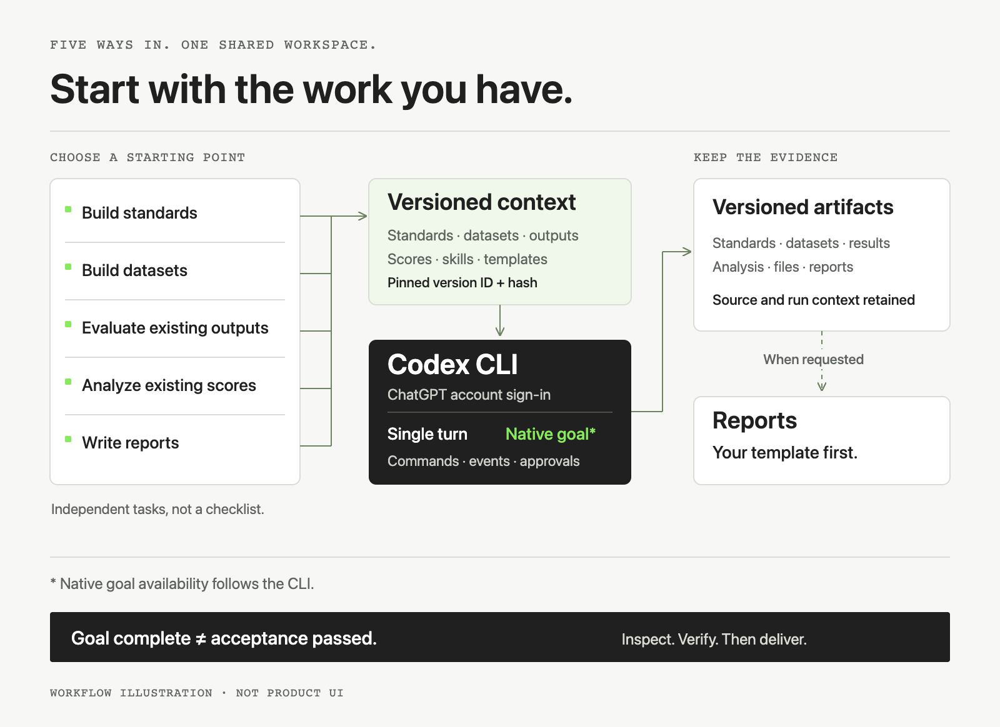
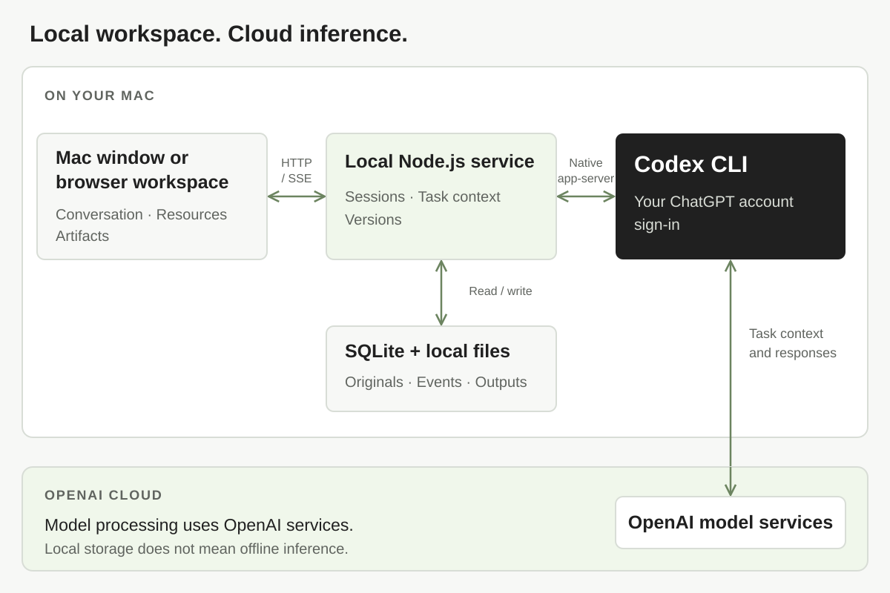

# OpenEval

[English](README.md) · [简体中文](README.zh-CN.md)

**An evaluation workspace for your Mac.** Build standards, organize datasets, evaluate existing outputs, analyze scores, and write reports with Codex CLI. Keep your materials, task history, and evidence together.

## Download for Mac

### [Download OpenEval for Apple Silicon ↓](https://github.com/YuxuanSha/openeval/releases/download/v0.2.0-beta.11-r1/OpenEval-0.2.0-build11-r1-macos-arm64.zip)

**Build 11 r1 · ZIP · 38.7 MB**  
**Requires:** an Apple M-series Mac, macOS 13.5+, and a GitHub account with access to this private repository. Intel, Windows, and Linux packages are not available.

> **Read before installing:** this private beta is ad-hoc signed, **not Apple Developer-ID signed or notarized**. Gatekeeper assessment returns `rejected`, so macOS may block the downloaded app. If blocked, stop and wait for a signed/notarized build or contact the maintainer. Do not disable macOS security protections. Installation on a second clean Mac has not been verified.

The file you need is **`OpenEval-0.2.0-build11-r1-macos-arm64.zip`**. It includes `OpenEval.app` and Node.js; no build tools or manual backend startup are required. The “Source code” archives on the Release page are for developers, not the desktop app.

## Quick start

### 1. Download and extract the app

Use the download button above while signed in to GitHub. Double-click the ZIP, then drag `OpenEval.app` from the extracted folder into **Applications**. If you have an older copy, quit it and retain it before replacing it.

### 2. Set up Codex CLI once

OpenEval uses your own **ChatGPT-authenticated Codex CLI** to run model tasks. If it is already installed and signed in, skip the installer and check `codex login status`.

For a new installation, open **Terminal** and run the [official Codex CLI installer](https://learn.chatgpt.com/docs/cli):

```sh
curl -fsSL https://chatgpt.com/codex/install.sh | sh
```

Open a new Terminal window, then sign in with your **ChatGPT account** in the browser:

```sh
codex login
codex login status
```

OpenEval reuses this login. An API key is not required or used by this app. [Official sign-in help](https://learn.chatgpt.com/docs/auth?surface=cli).

### 3. Open OpenEval and start a task

Open `OpenEval.app` from Applications. It opens its own window and starts its local service automatically. If the app was open during Codex setup, quit and reopen it.

The current interface is Chinese. Start a **new task (新任务)**, enter a request, and send it. For a first task that needs no dataset, try:

> Help me draft three criteria for evaluating the factual accuracy of a question-answering assistant. Include what evidence each criterion needs. Do not score any examples yet.

To evaluate your own material, import it, type **`@`** in the conversation to select the relevant versions, and state what you want evaluated. Inspect the execution and saved outputs before accepting a result. Model processing uses OpenAI's cloud services; the workspace and saved artifacts stay local.

<details>
<summary>Download troubleshooting, checksums, and detailed installation</summary>

- **Download shows 404:** sign in to a GitHub account that has access to `YuxuanSha/openeval`.
- **macOS blocks the app:** this beta is not notarized; retain the exact message and contact the maintainer or wait for a signed build.
- **Codex is unavailable:** run `codex login status` in Terminal, finish ChatGPT sign-in, then reopen OpenEval.
- **Detailed installation:** [English guide](docs/beta-install.en.md) · [中文安装说明](docs/beta-install.zh-CN.md).
- **Verify the ZIP:** [Release and SHA256SUMS.txt](https://github.com/YuxuanSha/openeval/releases/tag/v0.2.0-beta.11-r1) · [validation and known limits](docs/releases/v0.2.0-beta.11-r1.md).

</details>

<picture>
  <source media="(max-width: 640px)" srcset="docs/images/hero-mobile-v2.png">
  
</picture>

## Start with the work you have

You do not need to build a standard, create a dataset, and score a batch before every task. OpenEval has five independent starting points, plus free-form conversation.

| Start here | What you can do |
| --- | --- |
| **Build standards** | Turn goals and constraints into criteria, scales, and evidence requirements. Samples are optional at this stage. |
| **Build datasets** | Organize inputs, expectations, and sources while preserving record identity and original fields. |
| **Evaluate existing outputs** | Apply the selected standard to existing material and record findings with evidence. Missing prerequisites are surfaced before scoring. |
| **Analyze existing scores** | Investigate existing results without registering a new scoring batch. Keep original scores, units, denominators, and exclusions. |
| **Write reports** | Use available evidence and your selected template to produce a report. A report request does not imply a new evaluation. |

<picture>
  <source media="(max-width: 640px)" srcset="docs/images/workflow-mobile-v2.png">
  
</picture>

*Workflow illustration, not a product screenshot. The entry points are alternatives; they are not a required sequence.*

## Keep the context intact

**Pin what each run uses.** Select resources with `@`. Each reference binds a version ID and content hash, so updating a standard or template does not silently change an earlier task's evidence.

**Inspect the work as it happens.** Follow real CLI commands, tool output, approvals, turn events, and saved artifacts. Reloading restores state; reconnecting replays events without starting execution again. Cancelling preserves files already produced.

**Keep your report format.** Select a template version and continue refining it in conversation. Existing scores remain distinct from newly generated scores, and missing evidence remains distinct from a numeric zero.

**Reuse methods and memory.** Five built-in Skills support the five starting points. Upload `SKILL.md` or a ZIP bundle to store it as a resource; selected bundles are mounted for the task. Memory has a source and a user or project scope, with revision history and retraction.

**Archive from the conversation.** The agent receives an OpenEval task contract and writes a structured artifact manifest. The backend validates files, kinds, names, versions and source references before registering them in the corresponding library. Failed registration stays visible; revising an artifact creates an immutable version. See the [small verified workflow](docs/examples/synthetic-echo.md).

Use **文件分享 (File sharing)** to export selected snapshots and attachments as `.openeval.json`, then inspect and import them on another machine. This content package is separate from the application ZIP. See [file sharing](docs/file-sharing.md).

## A typical session

1. **Create a task.** An empty session immediately appears in recent tasks. Execution starts when you send a message.
2. **Reference the material you need.** Pin standards, inputs, existing outputs, scores, or templates by version. Inspect the task context and resolve important gaps.
3. **Choose execution settings.** Select a model and reasoning effort from the live CLI catalog. Use a single turn or native goal mode when supported.
4. **Review the evidence.** Inspect the run, its files, and its result. Request a template-based report when useful, then record acceptance separately.

The current interface is Chinese. This README uses English brand and workflow illustrations; it does not present translated mockups as real interface screenshots. Original synthetic-test screenshots remain development evidence.

[本机使用说明](docs/local-use.zh-CN.md) · [November 4 review](docs/review-2026-11-04.md)

## For developers: run from source

For terminal and agent integrations, see the [CLI and MCP beta guide](docs/cli-mcp.md).
The CLI can import versioned evidence, submit/inspect/cancel runs, and download
artifacts. The stdio MCP bridge defaults to read-only and connects to the same local
service; writes require explicit `--allow-write`. No credentials are bundled.

Verified on **macOS**, with **Node.js 24.22.1 for the backend** and **Node.js 22.22.3 for frontend builds**. The backend requires Node.js 24+; the frontend requires Node.js 22.12+. Other operating systems have not completed acceptance testing.

Install Codex CLI and sign in with your ChatGPT account. If you are already signed in, reuse that session. OpenEval does not ask for an API key or a model-provider configuration.

```sh
codex login
codex login status
```

From the repository root, install the backend and build the frontend:

```sh
npm ci
npm --prefix web ci
npm --prefix web run build
```

Then start the backend using **Node.js 24+**:

```sh
npm start
```

For the prebuilt native application, use the Mac download above; Node is bundled in that ZIP. For a source build, see the [macOS build guide](docs/desktop-macos.zh-CN.md). Both use a native window and manage their backend lifecycle; quit with ⌘Q. Source builds without the optional runtime archive need installed Node 24+. Codex CLI remains a separate dependency.

For the optional browser workflow, open <http://127.0.0.1:4318> after starting the service. Do not run the app and the browser launcher against the same data directory simultaneously.

```sh
npm run status
npm stop
```

The launcher starts a detached local process that survives closing its launch terminal. It does not install a system service or start at login. Repeated starts check the current instance; stopping verifies its identity.

| Setting | Purpose |
| --- | --- |
| `OPENEVAL_CODEX_BIN` | Path to an existing Codex CLI executable. |
| `OPENEVAL_NODE` | Node executable used by the macOS `.command` launchers. `npm start` uses the current Node. |
| `OPENEVAL_PORT` | Local server port; defaults to `4318`. |
| `OPENEVAL_DATA_DIR` | Override the local data directory. |

For split development, run `npm run dev` at the repository root and in `web/`. The frontend on `4317` proxies `/api` to the backend on `4318`. Ensure those ports are free first.

## Turn and goal modes

Models and reasoning-effort options come from the current CLI catalog. Availability can depend on the account, CLI, and model. Effort is a model setting, not a fixed amount of thinking text or time.

| Mode | Execution | Completion |
| --- | --- | --- |
| **Single turn** | One submission runs one native turn. Follow-up messages resume the same thread. | Messages, events, and artifacts are retained. |
| **Native goal** | Where supported, enable a native objective. The CLI can continue across native turns. New UI requests set no token budget, time limit, or turn cap. | Goal status, run status, turn status, and independent acceptance remain separate. |

Model and reasoning choices come from the live CLI catalog. The compact composer exposes the native goal objective without additional budget controls. Historical runs retain their original settings; retrying from the current UI starts without those retired limits. Cancelling pauses the goal before interrupting its active turn. A `complete` goal does not automatically become a passed acceptance check.

## Architecture and data



**Local storage is not offline inference.** Submitted context and referenced material may be sent through Codex CLI to the model service. File and command approvals are handled through the CLI and interface.

The launcher defaults to `.openeval-product/`; root-level `npm run dev` defaults to `.openeval/`. SQLite stores tasks, resource versions, runs, and events. `blobs/` stores SHA256-indexed originals; `workspaces/` stores task working directories. Browser storage holds unsent drafts and outstanding idempotency keys. Stop the service before backing up the full data directory.

The default installation includes five general-purpose Skills. Personal cases, credentials, private reports, and private document links are not bundled. Keep runtime data and credentials out of the repository.

## Optional Feishu / Lark integration

Feishu is not required. Local artifact preview and download are available; **an in-product Feishu export has not completed acceptance**. Export authenticated source documents through a separately authorized connection before importing them. Public HTTPS links can be imported directly when retrieval succeeds.

Any future Feishu connection requires the user's own permissions and destination. Account credentials and personal document identifiers do not belong in source or default configuration.

## Development status

This is a private beta. Real CLI checks cover synthetic workflows, resource archiving and template reporting. A separately authorized image sample produced a local report; its private inputs are excluded and it is not an accuracy benchmark. Feishu delivery and clean-Mac distribution remain pending.

Recorded checks cover persistent sessions, native continuation, fixed references, template use, existing-score analysis, cancellation with partial artifacts, selected Skill attachments, and a synthetic native goal spanning two turns. Interface fixtures, actual UI checks, and real CLI synthetic tasks are documented separately in [validation scope](docs/validation.md).

This is a single-machine preview. Multi-user permissions, scheduled evaluation, and distributed batch orchestration are outside the current implementation. PDF, Office, and image originals are retained, but there is no unified OCR or complete Office extraction service. An unavailable CLI produces a diagnostic, not simulated results.

```sh
# Backend checks: Node.js 24+
npm test

# Frontend protocol, type, and build checks
npm --prefix web run test:adapter
npm --prefix web run build
```

See [API-CONTRACT.txt](API-CONTRACT.txt) and [shared/contracts.ts](shared/contracts.ts) for the interface contract.

## License and acknowledgements

OpenEval's original code is licensed under [MIT](LICENSE). Third-party material retains its own terms; see [THIRD_PARTY_NOTICES.md](THIRD_PARTY_NOTICES.md) and the full license files. The current Markdown renderer is an independent adapter around MIT-licensed react-markdown and remark-gfm. Selected OpenDesign color-token declarations retain their supplied upstream license and attribution; its wording differs from canonical Apache-2.0 in sections 6 and 9, as documented in the notice. No whole-repository “pure MIT” claim is made.

[OpenDesign](https://github.com/nexu-io/open-design) informed the interface layout and conversation lifecycle. Source mappings and adaptation notices are tracked in [`web/OPENDESIGN_REFERENCE.md`](web/OPENDESIGN_REFERENCE.md) and [`web/third_party/opendesign/`](web/third_party/opendesign/). Final redistribution notices must follow the audited source actually included. OpenEval is independent and is not an official OpenDesign distribution.

The frontend uses React, Vite, TypeScript, and Lucide, each subject to its own terms. The hero is original AI-assisted brand artwork; the workflow diagram is an editable project illustration. Neither is a screenshot or a claim about completed evaluation results. See [visual assets](docs/images/ASSETS.md).
