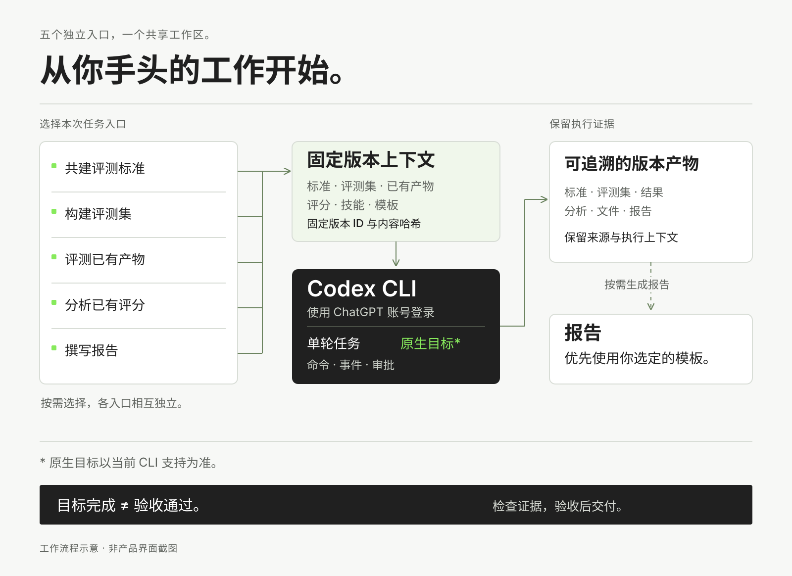
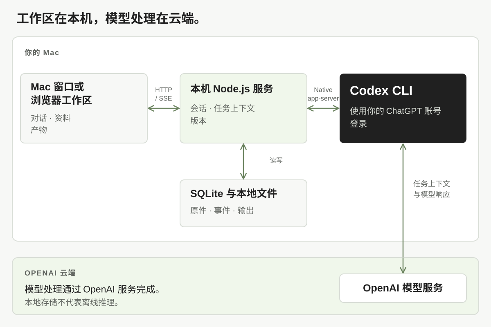

# OpenEval

[English](README.md) · **简体中文**

**在 Mac 上用对话完成评测工作。** 共建标准、整理评测集、评测已有产物、分析已有评分、撰写报告，让资料、执行过程和证据保存在同一个工作区。

## 下载 Mac 应用

### [下载 OpenEval（Apple 芯片版）↓](https://github.com/YuxuanSha/openeval/releases/download/v0.2.0-beta.11-r1/OpenEval-0.2.0-build11-r1-macos-arm64.zip)

**Build 11 r1 · ZIP 安装包 · 38.7 MB**  
**适用设备：** Apple M 系列芯片的 Mac，macOS 13.5 或更新版本。下载时需登录有本私有仓库权限的 GitHub 账号。当前没有 Intel、Windows 或 Linux 安装包。

> **安装前请注意：** 这是私有内测包，只有 ad-hoc 签名，**尚未完成 Apple Developer ID 签名或公证**。Gatekeeper 评估为 `rejected`，macOS 可能阻止打开下载的应用。如果被阻止，请停止安装、保留提示并联系维护者，或等待签名公证版；不要关闭系统安全保护。另一台干净 Mac 的安装尚未验证。

你要下载的文件是 **`OpenEval-0.2.0-build11-r1-macos-arm64.zip`**。里面已经包含 `OpenEval.app` 和 Node.js，无需自行编译或启动后台服务。Release 页里的 “Source code” 是开发用源码，不是 Mac 应用安装包。

## 快速开始

### 1. 下载并解压

登录 GitHub 后，点击上方下载按钮。双击 ZIP 解压，把文件夹中的 **`OpenEval.app` 拖入“应用程序”**。如果已装过旧版，先退出并保留旧应用，再替换。

### 2. 安装 Codex CLI 并登录一次

执行模型任务需要你自己的 **Codex CLI 和 ChatGPT 登录状态**。如果已经安装并登录，跳过安装命令，运行 `codex login status` 确认即可。

首次使用时，打开 Mac 的**“终端”**，运行 [Codex 官方安装命令](https://learn.chatgpt.com/docs/cli)：

```sh
curl -fsSL https://chatgpt.com/codex/install.sh | sh
```

安装完成后，重新打开一个终端窗口，执行以下命令，并在浏览器中登录自己的 **ChatGPT 账号**：

```sh
codex login
codex login status
```

OpenEval 会复用这次登录，应用不要求填写 API key，也不采用仅 API key 的登录方式。[官方登录说明](https://learn.chatgpt.com/docs/auth?surface=cli)。

### 3. 打开应用，发起第一个任务

在“应用程序”中打开 **OpenEval**。它会打开自己的窗口并自动启动本机服务。若安装 Codex 时应用已经开着，先退出再重新打开。

进入**新任务**，输入需求并发送。第一次可以直接试这句话，不需要先准备评测集：

> 请帮我制定一个问答准确性的评测标准，先给出三个维度和各自需要的证据，暂时不要给样本打分。

要评测自己的材料时，先导入资料，再在对话中输入 **`@`** 选择本次使用的具体版本，说明评测目标。执行结束后查看过程和保存的产物，再独立验收。工作区和产物保存在本机，模型处理通过 OpenAI 云端服务完成。

<details>
<summary>下载失败、安装受阻、校验文件与详细说明</summary>

- **下载显示 404：** 确认当前 GitHub 账号有 `YuxuanSha/openeval` 的访问权限。
- **macOS 提示无法打开或被阻止：** 当前包未公证，请保留原始提示并联系维护者，或等待签名版。
- **应用提示 Codex 不可用：** 在终端执行 `codex login status`，完成 ChatGPT 登录后重开 OpenEval。
- **详细安装步骤：** [中文安装说明](docs/beta-install.zh-CN.md) · [English guide](docs/beta-install.en.md)。
- **安装包校验与边界：** [Release 和 SHA256SUMS.txt](https://github.com/YuxuanSha/openeval/releases/tag/v0.2.0-beta.11-r1) · [版本验证与已知限制](docs/releases/v0.2.0-beta.11-r1.md)。

</details>

<picture>
  <source media="(max-width: 640px)" srcset="docs/images/hero-mobile.zh-CN.png">
  
</picture>

## 可以做什么

| 工作 | OpenEval 如何支持 |
| --- | --- |
| 共建评测标准 | 从目标和约束开始，逐步明确条款、尺度与证据要求；无样本也可以先建标准。 |
| 构建评测集 | 整理输入、期望和来源，保留记录身份；可查看结构化原始行与 case 详情。 |
| 评测现有产物 | 引用本次标准与待评材料，生成评分与证据；缺少关键依据时先补充。 |
| 分析已有机评 | 读取已有评分与批跑结果，保留原分数、单位、分母和排除项。此路径不登记新的评分批次。 |
| 按模板写报告 | 优先使用你选择的模板和当前版本，把结果、依据与证据限制写清楚。 |

这五条工作路径各有内置 Skill，也可以在自由对话中继续细化任务。上传 `SKILL.md` 或 ZIP 会保存为资源；任务中选定后才挂载。记忆支持来源、用户/项目范围、修订和撤回。

## 一次评测如何进行

1. **新建会话。** 描述目标、范围和交付物。空会话立即保存在近期任务中；发送消息后才开始执行。
2. **引用具体材料。** 用 `@` 选择标准、评测集、产物或模板的固定版本。引用绑定版本 ID 与内容哈希，更新资源不会替换旧任务的依据。
3. **检查执行设置。** 选择当前 CLI 支持的模型与推理力度，按需要选择单轮任务或目标模式。任务依据可查看，关键材料缺失会提示补充。
4. **跟踪实际执行。** 查看命令、工具输出、审批与 turn 状态。需要时停止；已有产物仍会保留。刷新或恢复事件连接不会重新发起运行。
5. **检查结果并交付。** 查看证据、结果和产物。需要报告时，优先按所选模板生成，并独立记录验收。目标显示 `complete` 不代表验收通过。

<picture>
  <source media="(max-width: 640px)" srcset="docs/images/workflow-mobile.zh-CN.svg">
  
</picture>

## 文件分享与终端接入

点击窗口顶部的「文件分享」，可将选定资料快照与图片附件导出为 `.openeval.json` 内容包；接收方检查清单后，在自己的 OpenEval 中导入独立副本。它与上方 Mac 应用安装 ZIP 是两种不同的文件。详见[文件分享说明](docs/file-sharing.md)。

终端和 Agent 可按 [CLI / MCP 内测说明](docs/cli-mcp.md)接入现有本机服务，导入版本化资料、提交或取消任务、查看和下载产物。MCP 默认只读，写入需显式开启 `--allow-write`；安装包不含个人凭据或评测数据。

## 关于配图

英文 README 使用英文配图，本页使用对应的中文宣传图、流程图与架构图。头图是原创 AI 辅助品牌插画，流程图和架构图是功能示意，并非产品截图。当前真实界面为中文；原始合成验证截图保留在开发证据中，没有用改字插画冒充实测。

各任务起点相互独立。可以直接建标准、构建评测集、评测已有产物、分析已有分数或写报告，不要求先走完“标准→集→评测”的完整链路。

## 开发者：从源码运行

已验证环境为 **macOS、后端 Node.js 24.22.1、前端构建 Node.js 22.22.3**。后端要求 Node.js 24+；前端要求 Node.js 22.12+。其他操作系统尚未完成验收。

先安装 Codex CLI，并在 CLI 中完成 ChatGPT 账号登录。已登录的用户无需重复登录；OpenEval 使用现有登录状态，应用内没有 API key 或模型 provider 配置。

```sh
codex login
codex login status
```

拿到源码后，在仓库根目录安装后端依赖并构建前端：

```sh
npm ci
npm --prefix web ci
npm --prefix web run build
```

前端构建完成后，使用 **Node.js 24+** 启动后端：

```sh
npm start
```

直接使用应用请下载上方 Mac ZIP，其中已包含 Node；源码构建参阅[桌面应用说明](docs/desktop-macos.zh-CN.md)，未选配内置运行时的源码构建仍需本机 Node 24+。应用打开自己的窗口，以 ⌘Q 退出；Codex CLI 为独立依赖。浏览器流程可使用 <http://127.0.0.1:4318> 或根目录的 `Start OpenEval.command` / `Stop OpenEval.command`。不要同时启动使用同一目录的两份服务。

```sh
npm run status
npm stop
```

启动器启动独立本地进程，关闭启动终端后仍会运行；不注册系统服务，也不设置开机启动。重复启动会核对现有实例，停止时会核实进程身份。

| 配置项 | 用途 |
| --- | --- |
| `OPENEVAL_CODEX_BIN` | 指向现有 Codex CLI 可执行文件。 |
| `OPENEVAL_NODE` | Mac `.command` 启动器使用的 Node 路径；`npm start` 使用当前 Node。 |
| `OPENEVAL_PORT` | 本地服务端口，默认 `4318`。 |
| `OPENEVAL_DATA_DIR` | 自定义本地数据目录。 |

前后端分开开发时，根目录运行 `npm run dev`；在 `web/` 中运行 `npm run dev`。前端 `4317` 将 `/api` 代理到后端 `4318`。先确保对应端口没有其他 OpenEval 实例。

## 模型、推理力度与执行模式

可选模型与 reasoning effort 从当前 CLI 动态读取，随账号、CLI 和模型能力变化。推理力度是模型档位，不表示固定思考字数或运行时间。

| 模式 | 行为 | 停止与验收 |
| --- | --- | --- |
| 单轮任务 / turn | 一次提交执行一个原生 turn；后续对话恢复同一 thread。 | 本轮结束后保留消息、事件和产物。 |
| 原生目标 / goal | 在 CLI 支持时设置目标，由原生目标继续后续 turn。新界面不设置 token 预算、时限或最多轮数。 | 原生目标、运行、turn 和独立验收分别记录。 |

模型与思考力度来自 CLI 实际返回的选项。历史运行保留原有配置，当前界面重试时不带已移除的预算控制。取消会先暂停目标，再中断当前 turn；不会把目标完成自动写成验收通过。

## 架构与数据



工作台与存储在本机，**模型处理仍在云端**。提交任务时，本次上下文和引用材料可通过 Codex CLI 发送给模型服务；本地部署不等于离线推理。文件和命令审批由 CLI 与界面协同处理。

手动启动器默认数据目录为 `.openeval-product/`；根目录 `npm run dev` 默认使用 `.openeval/`。SQLite 保存任务、资源版本、运行和事件；`blobs/` 保存按 SHA256 索引的原件，`workspaces/` 保存任务工作目录。浏览器仅保存未发送草稿和请求幂等键。停止服务后可备份整个数据目录。

默认安装只包含五个通用 Skill，不包含个人案例、账号凭据、业务报告或私有资料链接。运行数据、凭据和私人导入包不应提交到仓库。

## 可选：飞书 / Lark

飞书不是必需依赖。当前核心能力是本地产物预览与下载；**尚未提供已验收的应用内飞书导出**。需要登录的飞书资料应先通过你已授权的渠道导出，再导入文件。公开 HTTPS 链接可直接尝试导入，失败时会返回错误。

后续若接入飞书，需要由使用者单独配置连接、权限与目标位置。账号凭据和个人文档标识不进入源码或默认配置。

## 状态与边界

当前为私有内测。真实 CLI 已验证合成流程、自动归档、版本修订和模板报告。另一次获授权的图像小样本已生成本地报告，私有材料不随项目分发，判分不代表准确率。飞书交付和其他 Mac 的分发验收仍待完成。

已记录的验证覆盖：持久会话与续聊、固定版本、模板优先、已有评分分析、真实 CLI 取消与部分产物、选定 Skill 附件、原生目标自动两轮，以及新版界面的资源导航和移动布局。协议夹具、实际界面验证与真实模型合成验证分别记录，见[验证说明](docs/validation.md)。

当前版本面向单机工作流，尚不包含多用户权限、定时调度或大规模分布式批次编排。PDF、Office 和图片保留原件，但没有统一 OCR 或完整 Office 抽取服务。CLI 不可用时显示诊断，不生成模拟执行结果。

开发检查：

```sh
# 仓库根目录，Node.js 24+
npm test

# 前端协议检查与类型/构建检查
npm --prefix web run test:adapter
npm --prefix web run build
```

接口详见 [API-CONTRACT.txt](API-CONTRACT.txt)，共享类型见 [shared/contracts.ts](shared/contracts.ts)。

## 许可与致谢

OpenEval 自有代码采用 [MIT](LICENSE)；第三方材料保留各自条款，见 [THIRD_PARTY_NOTICES.md](THIRD_PARTY_NOTICES.md)。Markdown 渲染器现为基于 MIT 库的独立适配。少量 OpenDesign 色彩声明保留实际上游许可证；其第 6、9 条措辞与标准 Apache-2.0 有差异，已在说明中记录，不称整仓纯 MIT。

[OpenDesign](https://github.com/nexu-io/open-design) 对界面结构与会话生命周期的启发。来源映射与改编声明见 [`web/OPENDESIGN_REFERENCE.md`](web/OPENDESIGN_REFERENCE.md) 和 [`web/third_party/opendesign/`](web/third_party/opendesign/)。最终分发声明必须对应实际合入、经审计的源码。本项目与 OpenDesign 无官方关联。

前端使用 React、Vite、TypeScript 和 Lucide，各依赖仍受自身许可证约束。头图由内置图像生成工具辅助创作，工具未暴露可核实的底层型号，未标称使用 image2.5。流程图保留可编辑矢量源文件。
